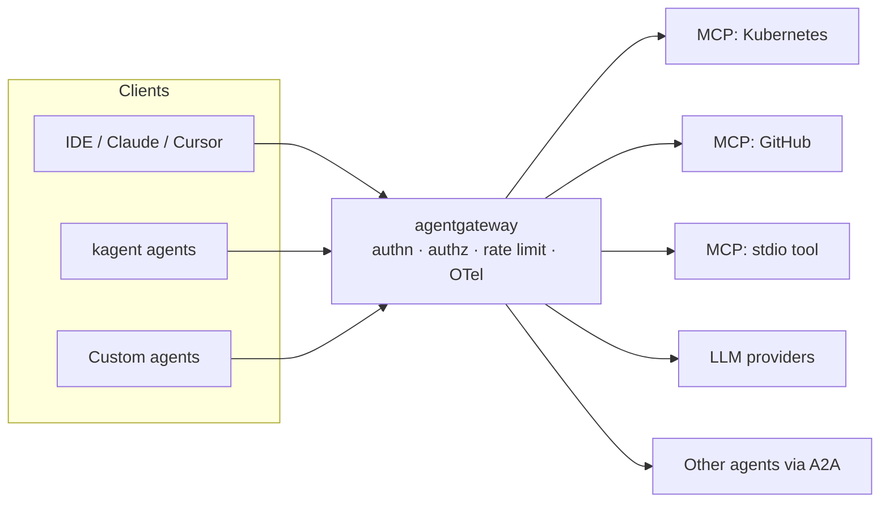

# Agent Gateway

!!! info "Version note"
    Written against **agentgateway v1.7.0** (November 2026). The config format has changed between releases. If a field below is rejected, compare it with the [standalone docs](https://agentgateway.dev/docs/) for your version.

## Introduction

As soon as you have more than one agent, you also have many MCP servers, several LLM providers and agents calling other agents. Each of these connections needs authentication, rate limits, logging and tracing. Building that into every server doesn't scale.

[agentgateway](https://agentgateway.dev/) is an open-source proxy (a [Linux Foundation](https://www.linuxfoundation.org/) project, written in Rust) built for this traffic. Think of it as an API gateway that understands agent protocols:

- **MCP gateway.** Federates many MCP servers (stdio, SSE, Streamable HTTP, even OpenAPI services) behind one endpoint.
- **A2A gateway.** Proxies agent-to-agent traffic.
- **LLM gateway.** Routes to OpenAI, Anthropic, Gemini, Bedrock and others, with failover, load balancing and spend controls.
- **Security.** JWT, API keys and OAuth for authentication. CEL-based authorization (RBAC) down to individual tools. Rate limiting and TLS.
- **Guardrails.** Regex filters, moderation APIs, Bedrock Guardrails, Model Armor and custom webhooks.
- **Observability.** OpenTelemetry metrics, logs and traces for every tool call.



## Why not a normal API gateway?

MCP and A2A are **stateful, session-based JSON-RPC** protocols. They often stream, and stdio servers aren't network services at all. A plain HTTP proxy can forward the bytes, but it can't:

- merge the tool lists of five servers into one,
- allow `list_pods` but deny `delete_pod` for a given user,
- start a local `npx` MCP server and expose it over HTTP,
- trace a single tool call end to end.

agentgateway can do all of these.

## Install (standalone)

```bash
curl -sL https://agentgateway.dev/install | bash -s -- --version v1.7.0
agentgateway --version
```

Running `agentgateway` with no arguments creates a starter config at `~/.config/agentgateway/config.yaml`. In this guide we pass our own file with `-f`.

!!! tip "Kubernetes"
    agentgateway also has a Kubernetes mode with a built-in control plane that is configured through the **Gateway API** (`Gateway`, `HTTPRoute` and so on). Start standalone to learn the concepts, then move to the [Kubernetes docs](https://agentgateway.dev/docs/) for cluster deployments.

## Example 1: expose a stdio MCP server over HTTP

Many MCP servers only speak stdio, so they can run only on your laptop. agentgateway can run one and publish it on a port:

```yaml title="config.yaml"
mcp:
  port: 3000
  policies:
    cors:
      allowOrigins: ["*"]      # lab only; restrict in real deployments
  targets:
    - name: everything
      stdio:
        cmd: npx
        args: ["@modelcontextprotocol/server-everything"]
```

```bash
agentgateway -f config.yaml
```

The startup log prints the MCP endpoint and the admin UI address (`http://localhost:15000/ui/` in the default setup). Test it with the MCP Inspector:

```bash
npx @modelcontextprotocol/inspector
# Transport: Streamable HTTP, URL: http://localhost:3000/mcp
```

## Example 2: federate several MCP servers

Add more `targets`. The gateway merges their tools into one MCP endpoint and prefixes each tool with its target name, so tools with the same name don't clash:

```yaml title="config.yaml"
mcp:
  port: 3000
  targets:
    - name: everything
      stdio:
        cmd: npx
        args: ["@modelcontextprotocol/server-everything"]
    - name: k8s
      mcp:
        host: http://k8s-mcp.tools.svc.cluster.local:8080/mcp   # remote Streamable HTTP server
```

Clients (an IDE, a [kagent](kagent.md) `RemoteMCPServer`, your own agent) now need only **one** URL, `http://<gateway>:3000/mcp`.

## Securing it

A production gateway should at least:

1. **Authenticate callers** with JWTs from your IdP (Keycloak, Entra ID, Okta). See [Keycloak + Kong](../Security/keycloak-kong.md) for a Keycloak realm setup you can reuse.
2. **Authorize per tool** with CEL rules, for example "only members of the `sre` group may call `k8s_*` tools; nobody may call delete tools".
3. **Rate limit** per client so that a looping agent can't overload a backend.
4. **Restrict CORS** to known origins instead of `*`.
5. **Terminate TLS** at the gateway.

The exact policy syntax for JWT and authorization is on the docs' security pages. Check it against your version, because the schema is still changing.

## Observability

agentgateway emits OpenTelemetry traces and metrics. Point it at your collector and every agent session becomes a trace: which client called which tool on which backend, how long each step took, and what failed. This fits with the [Prometheus & Grafana](<../Monitoring/1. setup_prometheus-grafana.md>) stack from the Monitoring section.

## Troubleshooting

| Symptom | Check |
| --- | --- |
| Config rejected at startup | The schema changed between versions. Compare with the example config shipped in that release. |
| stdio target fails | `cmd` must be on the gateway's `PATH` (for example, `npx` needs Node.js). Run the command by hand first. |
| Client connects but sees no tools | Wrong transport or path. Use Streamable HTTP and `/mcp`. |
| Browser client blocked | CORS. Add the client's origin to `allowOrigins`. |
| Admin UI not reachable | Check the address in the startup log. The admin port depends on your config. |

## References

- [agentgateway docs](https://agentgateway.dev/docs/)
- [agentgateway on GitHub](https://github.com/agentgateway/agentgateway)
- [Introduction to MCP](introduction-to-mcp.md)
- [KAgent](kagent.md)
