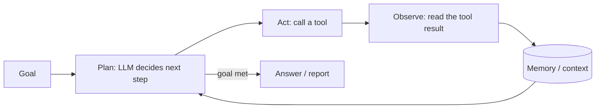
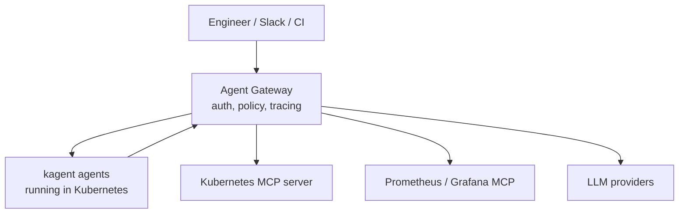

# Agentic AI

Agentic AI refers to artificial intelligence systems that possess agency, meaning they can make decisions and take actions autonomously to achieve specific goals. Unlike traditional AI systems that operate based on predefined rules or patterns, agentic AI can adapt to changing environments, learn from experiences, and interact with other agents or humans in a more dynamic manner.

## Chatbot vs. agent

A chatbot answers a question and stops. An agent is given a **goal**, and it keeps working until the goal is met or it gives up:

| | Chatbot / copilot | Agent |
| --- | --- | --- |
| Input | A prompt | A goal ("find out why checkout is returning 500s") |
| Output | Text | Actions plus a result |
| Steps | One model call | Many model calls in a loop |
| Touches systems? | No, a human copies the answer | Yes, through tools (kubectl, APIs, Git, tickets) |
| Who checks the work? | The human, every time | Guardrails, policies and approval gates |

## The agent loop

Almost every agent framework, from a 50-line script to [kagent](kagent.md), runs the same loop:

1. **Plan.** The model reads the goal, the conversation so far and the list of tools it may use, then picks the next step.
2. **Act.** It calls a tool, for example `kubectl get pods -n shop`, a Prometheus query or a GitHub API call.
3. **Observe.** The tool output is fed back into the model's context.
4. **Repeat** until the model decides it has enough to answer, or a limit (turns, time, cost) stops it.

## Building blocks

- **Model (the brain).** An LLM that can follow instructions and emit structured tool calls. Larger models plan better. Smaller or local models (for example, via Ollama) are cheaper and keep data in-house.
- **Tools (the hands).** Functions the agent can call. The [Model Context Protocol (MCP)](introduction-to-mcp.md) is now the common way to expose them, so one Kubernetes or Grafana MCP server works with any agent.
- **Memory.** Short-term memory is the context window. Long-term memory is a store the agent can search: runbooks, past incidents, architecture notes.
- **Instructions.** The system prompt defines the role ("You are an SRE for the payments cluster"), the boundaries and the expected output format.
- **Guardrails.** Limits on what the agent may do: read-only credentials, allow-lists of tools, max turns, spend caps and human approval for anything destructive.

## Patterns you will see

- **Single agent with tools.** One model, a handful of tools. Good for focused jobs such as "summarise this alert".
- **Router / orchestrator.** A top-level agent hands sub-tasks to specialists (a Kubernetes agent, a Prometheus agent, a Helm agent).
- **Agent-to-agent (A2A).** Agents running as separate services call each other over a standard protocol. They can be in different teams or written in different frameworks.
- **Human in the loop.** The agent proposes and a person approves before anything changes. This is the right default for production.

## Where agents help in DevOps

| Use case | What the agent does |
| --- | --- |
| Incident triage | Reads alerts, pulls logs, metrics and traces, and posts a first-pass root cause in the incident channel |
| Kubernetes troubleshooting | Explains `CrashLoopBackOff`, pending pods, failing probes and bad rollouts |
| Change review | Reviews Helm/Kustomize diffs and Terraform plans for risky changes |
| Cost and capacity | Spots over-provisioned workloads and suggests requests and limits |
| Security | Runs scanners, ranks findings and opens tickets (see [CAI](cai-cybersecurity-agent.md)) |
| ChatOps | Answers "what changed in prod in the last hour?" from Slack |

## Risks and how to contain them

!!! warning "An agent has the permissions of its credentials"
    If the agent's ServiceAccount can delete namespaces, then a confused model, a bad prompt or a prompt injection hidden in a log line can delete namespaces too.

- **Least privilege.** Start read-only. Give each agent its own ServiceAccount and scope RBAC to the namespaces it needs.
- **Prompt injection.** Treat everything a tool returns (logs, web pages, issue comments) as untrusted data, never as instructions.
- **Hallucinated actions.** Require dry runs (`kubectl --dry-run=server`, `terraform plan`) and human approval before writes.
- **Cost runaway.** Cap turns, tokens and spend per task.
- **Auditability.** Log every tool call with inputs and outputs. Put agent traffic through a gateway such as [agentgateway](agent-gateway.md) so you get a single place for auth, policy and tracing.
- **Data leakage.** Know where your prompts go. Use a self-hosted model for sensitive clusters.

## The stack in this section

- [Introduction to MCP](introduction-to-mcp.md): the protocol agents use to reach tools.
- [KAgent](kagent.md): run agents as Kubernetes resources.
- [Agent Gateway](agent-gateway.md): one proxy in front of MCP servers, agents and LLMs.
- [CAI Cybersecurity Agent](cai-cybersecurity-agent.md): an agent framework built for security testing.

## References

- [Model Context Protocol](https://modelcontextprotocol.io/)
- [kagent](https://kagent.dev/)
- [agentgateway](https://agentgateway.dev/)
- [OWASP Top 10 for LLM Applications](https://owasp.org/www-project-top-10-for-large-language-model-applications/)
