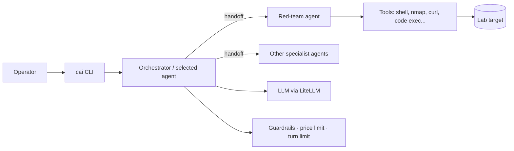

# CAI Cybersecurity Agent

!!! danger "Authorized use only"
    CAI runs real offensive tooling (scanners, exploit attempts, shell commands). Only point it at systems you **own** or have **written permission** to test, inside an isolated lab. Unauthorized testing is illegal in most countries. The project's own docs say it must not be used for cybercrime.

!!! warning "Project status (November 2026)"
    The open-source CAI repository was **archived on 28 August 2026** and is read-only. It gets no new releases, bug fixes or security patches, and the docs describe it as unmaintained attack tooling. Alias Robotics now points users to a commercial successor. The last public PyPI release is **0.5.10**. Use CAI to learn and experiment in labs, not as a supported production tool.

## Introduction

[CAI (Cybersecurity AI)](https://github.com/aliasrobotics/cai) is an agent framework from **Alias Robotics** for building AI agents that do security work: reconnaissance, vulnerability discovery, exploitation in CTFs, bug bounty triage and defensive analysis. It is built on the OpenAI Agents SDK pattern and talks to 300+ models through LiteLLM, including OpenAI, Anthropic, DeepSeek and local models via Ollama.

It is a useful case study in [agentic AI](agentic-ai.md). It has the same loop (plan, act, observe), but the tools are `nmap`, `curl`, shell commands and exploit code instead of `kubectl`.

### License

CAI is **not** plain MIT. Its LICENSE file mixes MIT-licensed code (derived from openai-agents-python) with proprietary parts under a **research-use-only** license. **Commercial use is prohibited** without a commercial license. Read the LICENSE before using it at work.

## How it works



- **Agents.** Specialists with their own prompts and tools. The default is an `orchestration_agent` that hands work to the others, such as `redteam_agent`. Run `/agent` inside CAI to list what your version ships.
- **Tools.** Command execution, network tools, code execution and web requests. These are what make CAI powerful and dangerous.
- **Handoffs.** Agents can pass a task to a better-suited agent.
- **Human in the loop.** The operator can interrupt, redirect or stop the agent at any time.
- **Limits and guardrails.** Spend caps, turn and interaction caps, and optional prompt-injection guardrails.
- **Tracing.** OpenTelemetry tracing of each step.

## Set up a lab

Never test against the internet. Build a target you own on an isolated Docker network:

```bash
docker network create --internal cai-lab
docker run -d --name dvwa --network cai-lab vulnerables/web-dvwa
```

Run CAI on the same network, or on a host that can reach only that network. With `--internal`, the lab has no route to the internet, so the agent can't wander off target. Your CAI host still needs internet access to reach the LLM API, unless you use a local model.

## Install

CAI recommends Python 3.12:

```bash
python3.12 -m venv cai_env
source cai_env/bin/activate
pip install cai-framework==0.5.10
```

## Configure

Create a `.env` in your working directory. Use placeholders and **never commit real keys**:

```dotenv title=".env"
# Model provider (pick one)
OPENAI_API_KEY="<your-openai-key>"
# ANTHROPIC_API_KEY="<your-anthropic-key>"
# OLLAMA_API_BASE="http://localhost:11434/v1"   # local models, data stays on your machine

CAI_MODEL="gpt-4o"                  # or e.g. ollama/qwen2.5:72b
CAI_AGENT_TYPE="redteam_agent"      # default is orchestration_agent

# Safety and cost limits
CAI_PRICE_LIMIT="2"                 # dollars per conversation
CAI_MAX_TURNS="30"
CAI_GUARDRAILS="true"               # prompt-injection guardrails (off by default)

# Observability
CAI_TRACING="true"
CAI_TELEMETRY="false"               # opt out of telemetry
```

Useful variables:

| Variable | Default | Purpose |
| --- | --- | --- |
| `CAI_MODEL` | `alias1` | Model used by the agents |
| `CAI_AGENT_TYPE` | `orchestration_agent` | Which agent starts the session |
| `CAI_PRICE_LIMIT` | `1` | Spend cap in dollars. When it is reached, only CLI commands work. |
| `CAI_MAX_TURNS` / `CAI_MAX_INTERACTIONS` | `inf` | Caps on agent turns and tool actions |
| `CAI_GUARDRAILS` | `false` | Enable prompt-injection guardrails |
| `CAI_TRACING` | `true` | OpenTelemetry tracing |
| `CAI_TELEMETRY` | `true` | Usage telemetry |
| `CAI_DEBUG` | `1` | Verbosity (0–2) |
| `CTF_NAME`, `CTF_IP`, `CTF_SUBNET` | – | Describe a CTF / lab target |

!!! note
    The default model `alias1` needs a paid Alias key. Set `CAI_MODEL` to a provider you have a key for, or to an Ollama model.

## Run it

```bash
CAI_LICENSE_OFF=1 cai     # the open-source build skips the license check this way
```

The first start can take up to 30 seconds. Inside the REPL:

| Command | What it does |
| --- | --- |
| `/help`, `/help topics` | Built-in help |
| `/help var CAI_MODEL` | Explain a variable |
| `/agent` | List or switch agents |
| `/env list`, `/env set` | Show or change settings live |

Give it a scoped task that names the lab target:

```text
Target: the DVWA container "dvwa" on the cai-lab Docker network (authorized lab).
Scope: only this host. Do not scan other addresses.
Task: enumerate open services and identify the web application and its version.
Report findings with evidence. Do not attempt exploitation.
```

Watch every command it proposes. Interrupt if it drifts out of scope.

## Using it responsibly in a DevOps team

- **Lab or staging only**, on isolated networks, with written scope.
- **Prefer local models** (Ollama) when target data is sensitive. Otherwise scan results go to a third-party API.
- **Keep the price and turn limits on.** Agent loops are cheap per step but add up quickly.
- **Turn guardrails on.** A target can return text crafted to hijack the agent (prompt injection), and the archived project won't fix the known weaknesses.
- **Log everything.** Keep the traces as evidence of what was done and when.
- For continuous, supported checks inside Kubernetes, use maintained scanners such as [Kubescape](../Security/KubeScape.md) and [M9Sweeper](../Security/M9Sweeper.md). Use CAI-style agents to explore, not as your control.

## References

- [CAI on GitHub (archived)](https://github.com/aliasrobotics/cai)
- [CAI documentation](https://aliasrobotics.github.io/cai/)
- [CAI environment variables](https://aliasrobotics.github.io/cai/environment_variables/)
- [Agentic AI](agentic-ai.md)
