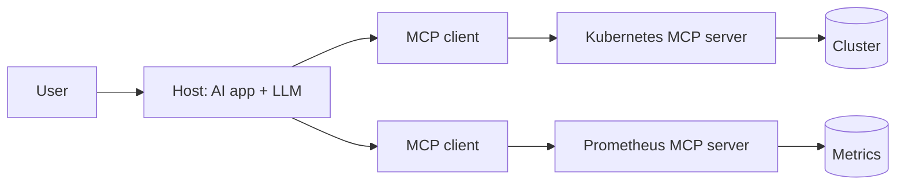

# Introduction to MCP

The **Model Context Protocol (MCP)** is an open protocol that standardizes how AI applications connect to external tools and data. Without it, every model needs a custom integration for every system it touches. With it, you write one MCP server for a system (say, your Kubernetes cluster or Grafana) and any MCP-capable AI app can use it.

It is often described as "USB-C for AI": one standard port instead of a drawer full of adapters.

## Architecture

MCP uses a client–server model built on JSON-RPC 2.0:

| Role | What it is | Example |
| --- | --- | --- |
| **Host** | The AI application the user interacts with | Claude Desktop, an IDE, a custom agent |
| **Client** | A connector inside the host, one per server | Created by the host for each server it connects to |
| **Server** | A program that exposes capabilities from one system | A Kubernetes, GitHub or Prometheus MCP server |

## What a server can expose

- **Tools:** actions the model can call, such as `get_pods`, `restart_deployment` or `query_metrics`.
- **Resources:** read-only context such as files, logs, config or database rows.
- **Prompts:** reusable, parameterized prompt templates.

## Transports

- **stdio:** the host launches the server as a local subprocess. This is simple and good for local tools.
- **Streamable HTTP:** the server runs remotely and is reached over HTTP. Use it for shared or hosted servers.

## Why it matters for DevOps

- **One integration, many agents:** expose your platform once and reuse it from any assistant or agent framework.
- **Least privilege:** each server decides exactly which operations exist, and you can make servers read-only.
- **Auditability:** tool calls are structured requests you can log, review and gate behind approvals.

!!! warning "Treat MCP servers like any other privileged service"
    A server that can `kubectl apply` is as powerful as the credentials it runs with. Scope its RBAC tightly, prefer read-only tools for exploration, and require human approval for destructive actions.

## Further reading

- [Model Context Protocol documentation](https://modelcontextprotocol.io)
- [MCP specification](https://modelcontextprotocol.io/specification)
- [Agentic AI](agentic-ai.md) on this site
