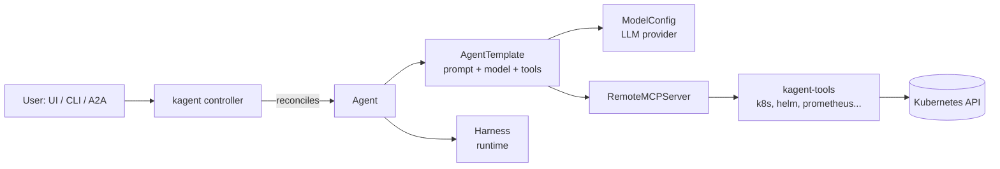

# KAgent

!!! info "Version note"
    Written against the **kagent 1.0.x** docs (November 2026). kagent 1.0 changed its resources a lot compared to 0.10.x: it uses the `api.kagent.dev/v1alpha3` API group and has no in-place upgrade from 0.10.x. If you run an older version, check `kubectl api-resources | grep kagent` and `kubectl explain agent.spec` before copying the YAML below.

## Introduction

[kagent](https://kagent.dev/) is an open-source framework for running AI agents **inside Kubernetes**. You define an agent the same way you define a Deployment. You write YAML, `kubectl apply` it, and a controller turns it into a running agent that can call tools in your cluster.

It is a [Cloud Native Computing Foundation](https://www.cncf.io/) project, built for DevOps and platform teams who want agents that:

- are versioned in Git and deployed with GitOps like everything else,
- use Kubernetes RBAC and namespaces for isolation,
- reach tools through the [Model Context Protocol (MCP)](introduction-to-mcp.md),
- can be called from a UI, the CLI or other agents.

## How it works



| Piece | Role |
| --- | --- |
| **Controller** | Watches kagent resources and runs the agents |
| **UI** | Web console to chat with agents and inspect their tool calls |
| **CLI (`kagent`)** | Installs kagent, creates sessions and invokes agents |
| **AgentTemplate** | The agent's "brain": system prompt, model config and tool bindings |
| **Agent** | A runnable agent that points to a template and a harness |
| **Harness** | The runtime the agent executes in |
| **RemoteMCPServer** | An MCP endpoint (in or out of the cluster) whose tools agents can use |
| **kagent-tools** | Built-in MCP server with Kubernetes, Helm, Istio, Argo, Prometheus and other tools |

## Prerequisites

- A Kubernetes cluster. The kagent 1.0 docs require Kubernetes **1.37+**. For a lab:

    ```bash
    kind create cluster --name kagent --image kindest/node:v1.37.0
    ```

- `kubectl` and `helm`
- An API key for your LLM provider (this guide uses OpenAI)

## Install

### 1. Install the CLI

```bash
# Pin the version you tested with
curl -sL https://kagent.dev/install | bash -s -- --version v1.0.0
kagent version
```

### 2. Install kagent into the cluster

The CLI is the easiest path. It wraps the Helm charts and reads the provider key from your environment:

```bash
export OPENAI_API_KEY="<your-openai-api-key>"
kagent install --namespace kagent
```

Pass `--config kagent-config.yaml` to override Helm values.

??? note "Installing with Helm instead"
    The charts are published as OCI artifacts:

    ```bash
    helm install kagent-crds oci://ghcr.io/kagent-dev/kagent/helm/kagent-crds \
      --version 1.0.0 -n kagent --create-namespace

    kubectl create secret generic kagent-openai -n kagent \
      --from-literal=OPENAI_API_KEY="${OPENAI_API_KEY}"

    helm install kagent oci://ghcr.io/kagent-dev/kagent/helm/kagent \
      --version 1.0.0 -n kagent
    ```

    The chart reads the `kagent-openai` Secret by default, so no extra value is needed for it. In 1.0 the Helm path also needs a PostgreSQL database and a few supporting charts. Follow the [installation guide](https://kagent.dev/docs/kagent) step by step if you use Helm or GitOps.

### 3. Check that it is running

```bash
kubectl get pods -n kagent
kubectl get remotemcpservers -n kagent
```

You should see the controller, the UI and the `kagent-tools` pods, plus a `RemoteMCPServer` named `kagent-tool-server`.

### 4. Open the UI

```bash
kubectl port-forward -n kagent svc/kagent-ui 8082:8080
```

Then open [http://localhost:8082](http://localhost:8082).

## Build a read-only troubleshooting agent

Our goal is an agent that can look at workloads and explain why they are unhealthy, but **cannot change anything**.

### 1. The template: prompt, model and tools

```yaml title="k8s-triage-template.yaml"
apiVersion: api.kagent.dev/v1alpha3
kind: AgentTemplate
metadata:
  name: k8s-triage
  namespace: kagent
spec:
  description: Read-only Kubernetes troubleshooting assistant
  modelConfig:
    name: default-model-config   # created by the installer
  systemPrompt: |
    You are an SRE assistant for a Kubernetes platform team.
    - Investigate using the tools you have. Never guess resource names.
    - You are READ-ONLY. If a fix needs a change, write the exact
      kubectl or YAML change for a human to apply.
    - Finish with: Summary, Evidence, Likely cause, Suggested fix.
  tools:
    - mcp:
        server:
          kind: RemoteMCPServer
          name: kagent-tool-server
        tools:                      # allow-list; leave empty to expose all tools
          - k8s_get_resources
          - k8s_describe_resource
          - k8s_get_pod_logs
          - k8s_get_events
```

!!! tip "Allow-list the tools"
    The `tools` list under `mcp` is the main guardrail. Leave out any create, patch, delete or apply tools and the model cannot call them, however it is prompted. Look up the exact tool names in the UI or with `kubectl describe remotemcpserver kagent-tool-server -n kagent` for your version.

### 2. The agent

```yaml title="k8s-triage-agent.yaml"
apiVersion: api.kagent.dev/v1alpha3
kind: Agent
metadata:
  name: k8s-triage
  namespace: kagent
spec:
  template:
    ref:
      name: k8s-triage
  harnessRef:
    name: default-harness   # see note below
```

!!! note
    `harnessRef` must point to a `Harness` that exists in your cluster. List them with `kubectl get harness -n kagent`. If none exists, create one as shown in the [Your first agent](https://kagent.dev/docs/kagent) guide.

```bash
kubectl apply -f k8s-triage-template.yaml -f k8s-triage-agent.yaml
kubectl get agents -n kagent
```

### 3. Try it

Break something on purpose:

```bash
kubectl create deployment broken --image=nginx:does-not-exist
```

Then ask the agent from the CLI:

```bash
SESSION_ID=$(kagent agent session create --agent k8s-triage)
kagent agent invoke --session "$SESSION_ID" \
  --task "Why is the 'broken' deployment in the default namespace not ready?"
```

You can also ask from the UI. The agent should list the pods, find `ImagePullBackOff`, read the events and suggest fixing the image tag.

## Add your own MCP server

Any MCP server that speaks Streamable HTTP or SSE can be registered:

```yaml title="grafana-mcp.yaml"
apiVersion: api.kagent.dev/v1alpha3
kind: RemoteMCPServer
metadata:
  name: grafana-mcp
  namespace: kagent
spec:
  description: Grafana dashboards, Prometheus and Loki queries
  url: http://grafana-mcp.monitoring.svc.cluster.local:8000/mcp
  protocol: STREAMABLE_HTTP
  timeout: 30s
```

Then add it to the template's `tools` list next to `kagent-tool-server`. If you run many MCP servers, put [Agent Gateway](agent-gateway.md) in front of them and register only the gateway.

## Security checklist

- [x] Allow-list tools per agent. Don't expose every tool by default.
- [x] Give the tool server's ServiceAccount the smallest RBAC it needs. A read-only `ClusterRole` (`get`, `list`, `watch`) is a good start.
- [x] Keep provider keys in Secrets, or better, External Secrets or Vault. Never put them in Git.
- [x] Treat pod logs and events as untrusted input, because they can carry prompt injections.
- [x] Watch token spend. Agent loops can make many model calls per question.

## Troubleshooting

| Symptom | Check |
| --- | --- |
| `no matches for kind "Agent"` | The CRDs are missing or a different version is installed. Run `kubectl api-resources \| grep kagent`. |
| Agent stays not ready | `kubectl describe agent <name> -n kagent`, then check the referenced template, harness and model config exist |
| Model errors / 401 | The provider Secret is missing or wrong. `kubectl get secret -n kagent`, then check the controller logs. |
| Tool calls fail | `kubectl logs -n kagent deploy/kagent-tools`. Check the RemoteMCPServer URL and RBAC. |
| UI does not load | Is the port-forward still running? `kubectl get svc -n kagent kagent-ui` |

## References

- [kagent docs](https://kagent.dev/docs)
- [kagent on GitHub](https://github.com/kagent-dev/kagent)
- [Introduction to MCP](introduction-to-mcp.md)
- [Agent Gateway](agent-gateway.md)
