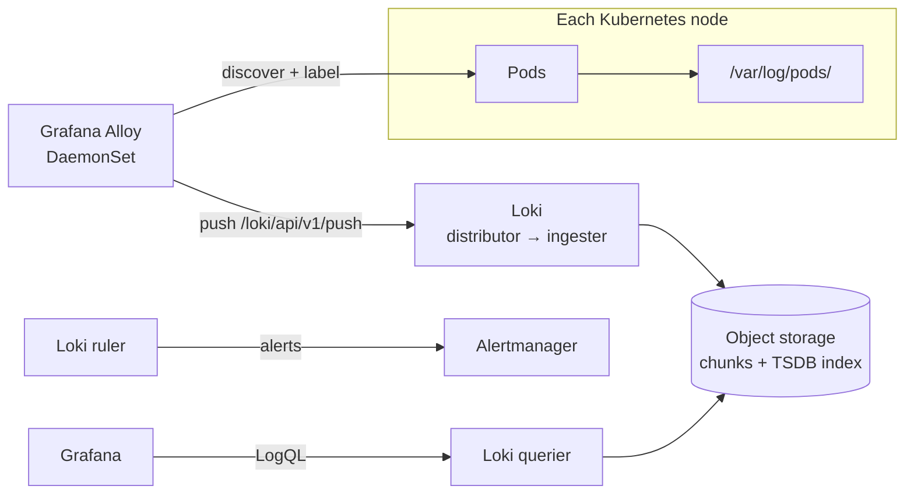

# Loki

!!! info "Version note"
    Written in November 2026. Two recent changes matter:

    - The Loki Helm chart moved to the **Grafana Community** repo (`grafana-community/loki`) in March 2026.
    - **Promtail reached end of life on 2 March 2026.** Use **Grafana Alloy** to collect logs. Older guides that use Promtail still work, but Promtail gets no updates.

    In chart 12.0.0 and later, the `SingleBinary` deployment mode is called `Monolithic`.

## Introduction

[Grafana Loki](https://grafana.com/oss/loki/) is a log aggregation system that works like Prometheus, but for logs. Its key design choice is that **it indexes only labels, not the log text**. Log lines are compressed into chunks and stored in object storage. Loki is cheap to run and simple to operate, and it fits well with Kubernetes, where every log line already carries labels (namespace, pod, container).

| | Loki | Elasticsearch / OpenSearch |
| --- | --- | --- |
| Indexes | Labels only | Full text |
| Storage | Object storage (S3, GCS, Azure, filesystem) | Local disks / SSD |
| Cost at scale | Low | High |
| Query language | LogQL (PromQL-like) | Lucene / KQL / DSL |
| Best at | "Show me logs for this pod/app/time" | Arbitrary full-text search and analytics |

## Architecture



- **Alloy** finds pods, attaches labels and pushes log lines.
- The **distributor** and **ingester** receive the logs, batch them into chunks and flush them to storage.
- The **querier** runs LogQL for Grafana.
- The **ruler** evaluates alert rules written in LogQL and sends alerts to Alertmanager.

### Deployment modes

| Mode | When to use |
| --- | --- |
| `Monolithic` (formerly `SingleBinary`) | Labs, dev, small clusters. All components run in one process. Use 3+ replicas for HA. |
| `SimpleScalable` | Being deprecated. Avoid for new installs. |
| `Microservices` | Production at scale. Each component scales on its own. |

This guide uses **Monolithic** with filesystem storage so you can follow it on any cluster. Production setups should use object storage.

## 1. Install Loki

```bash
helm repo add grafana-community https://grafana-community.github.io/helm-charts
helm repo update
```

```yaml title="loki-values.yaml"
deploymentMode: Monolithic

loki:
  auth_enabled: false            # single tenant; turn on for multi-tenancy
  commonConfig:
    replication_factor: 1        # required with a single replica
  schemaConfig:
    configs:
      - from: "2024-04-01"
        store: tsdb
        object_store: filesystem
        schema: v13
        index:
          prefix: loki_index_
          period: 24h
  storage:
    type: filesystem             # use s3 / gcs / azure in production
  limits_config:
    allow_structured_metadata: true
    volume_enabled: true
    retention_period: 168h       # 7 days
  compactor:
    retention_enabled: true
    delete_request_store: filesystem
  pattern_ingester:
    enabled: true
  rulerConfig:
    enable_api: true

singleBinary:                    # values key kept this name after the mode rename; confirm with `helm show values`
  replicas: 1
  persistence:
    size: 20Gi

# Turn off the components used by the other modes
backend:   { replicas: 0 }
read:      { replicas: 0 }
write:     { replicas: 0 }
ingester:  { replicas: 0 }
querier:   { replicas: 0 }
queryFrontend:  { replicas: 0 }
queryScheduler: { replicas: 0 }
distributor:    { replicas: 0 }
compactor:      { replicas: 0 }
indexGateway:   { replicas: 0 }
bloomPlanner:   { replicas: 0 }
bloomBuilder:   { replicas: 0 }
bloomGateway:   { replicas: 0 }
```

```bash
helm install loki grafana-community/loki \
  -n loki --create-namespace -f loki-values.yaml

kubectl get pods -n loki
```

!!! tip "Pin your versions"
    Add `--version <chart-version>` (see `helm search repo grafana-community/loki`) so that upgrades are deliberate. Run `helm show values grafana-community/loki` to confirm the keys for the version you install.

??? example "Production storage (S3)"
    ```yaml
    loki:
      schemaConfig:
        configs:
          - from: "2024-04-01"
            store: tsdb
            object_store: s3
            schema: v13
            index: { prefix: loki_index_, period: 24h }
      storage:
        type: s3
        bucketNames:
          chunks: my-loki-chunks
          ruler: my-loki-ruler
        s3:
          region: ap-south-1
    ```
    Use IRSA or workload identity instead of static keys.

## 2. Ship pod logs with Grafana Alloy

```bash
helm repo add grafana https://grafana.github.io/helm-charts
helm repo update
```

```yaml title="alloy-values.yaml"
alloy:
  configMap:
    content: |
      // Find pods on this node only (Alloy runs as a DaemonSet).
      // Relies on HOSTNAME being the node name, which the grafana/alloy chart sets
      // from spec.nodeName. If no logs arrive, check: kubectl exec ds/alloy -- env | grep HOSTNAME
      discovery.kubernetes "pod" {
        role = "pod"
        selectors {
          role  = "pod"
          field = "spec.nodeName=" + coalesce(sys.env("HOSTNAME"), constants.hostname)
        }
      }

      // Turn Kubernetes metadata into Loki labels
      discovery.relabel "pod_logs" {
        targets = discovery.kubernetes.pod.targets

        rule {
          source_labels = ["__meta_kubernetes_namespace"]
          target_label  = "namespace"
        }
        rule {
          source_labels = ["__meta_kubernetes_pod_name"]
          target_label  = "pod"
        }
        rule {
          source_labels = ["__meta_kubernetes_pod_container_name"]
          target_label  = "container"
        }
        rule {
          source_labels = ["__meta_kubernetes_pod_label_app_kubernetes_io_name"]
          target_label  = "app"
        }
        rule {
          source_labels = ["__meta_kubernetes_namespace", "__meta_kubernetes_pod_container_name"]
          separator     = "/"
          target_label  = "job"
        }
      }

      // Tail logs through the Kubernetes API (no hostPath mounts needed)
      loki.source.kubernetes "pod_logs" {
        targets    = discovery.relabel.pod_logs.output
        forward_to = [loki.process.pod_logs.receiver]
      }

      loki.process "pod_logs" {
        stage.static_labels {
          values = { cluster = "dev-cluster" }
        }
        forward_to = [loki.write.default.receiver]
      }

      loki.write "default" {
        endpoint {
          url = "http://loki.loki.svc.cluster.local:3100/loki/api/v1/push"
        }
      }
controller:
  type: daemonset
```

```bash
helm install alloy grafana/alloy -n loki -f alloy-values.yaml
kubectl get pods -n loki -l app.kubernetes.io/name=alloy
```

!!! warning "Keep label cardinality low"
    Labels should describe **where** a log came from (cluster, namespace, app, container), not **what** it says. Never use request IDs, user IDs or pod IPs as labels. High cardinality is the main way people break Loki. Put those values in the log line or in structured metadata.

## 3. Add Loki to Grafana

If you followed the [Prometheus & Grafana](<../Monitoring/1. setup_prometheus-grafana.md>) guide, add a data source. Either click through the UI (**Connections → Data sources → Loki**) or provision it:

```yaml
apiVersion: 1
datasources:
  - name: Loki
    type: loki
    access: proxy
    url: http://loki.loki.svc.cluster.local:3100
```

Then open **Explore**, pick **Loki** and run `{namespace="kube-system"}`.

## 4. LogQL cheat sheet

```logql
# All logs for an app
{namespace="shop", app="checkout"}

# Lines containing "error", case-insensitive, excluding health checks
{namespace="shop", app="checkout"} |~ "(?i)error" != "/healthz"

# Parse JSON logs and filter on a field
{app="checkout"} | json | level="error" and status >= 500

# Parse logfmt and show one field only
{app="api"} | logfmt | line_format "{{.method}} {{.path}} {{.duration}}"

# Error rate per app over 5 minutes (a metric from logs)
sum by (app) (rate({namespace="shop"} |= "error" [5m]))

# Top 5 noisiest pods in the last hour
topk(5, sum by (pod) (count_over_time({namespace="shop"}[1h])))

# p95 latency from a logged duration field
quantile_over_time(0.95, {app="api"} | logfmt | unwrap duration_ms [5m]) by (app)
```

Pattern: **stream selector** `{...}` → **filters** `|=`, `!=`, `|~` → **parsers** `json`, `logfmt`, `pattern` → **label filters** → optional **metric** wrapper. Filter as early as you can, because it makes queries much faster.

## 5. Alert on logs

With `rulerConfig.enable_api: true`, Loki can evaluate Prometheus-style rules written in LogQL. You can also create the same rule as a Grafana-managed alert from Explore.

```yaml
groups:
  - name: checkout-logs
    rules:
      - alert: CheckoutErrorSpike
        expr: sum(rate({namespace="shop", app="checkout"} |= "error" [5m])) > 5
        for: 10m
        labels:
          severity: warning
        annotations:
          summary: "checkout is logging more than 5 errors/s"
```

Send these to the same Alertmanager routes as your metric alerts ([Google Chat](<../Monitoring/2. gmail_integration.md>), [Slack](<../Monitoring/3. slack_integration.md>)).

## Retention

Retention is enforced by the **compactor**. The values above keep 7 days (`retention_period: 168h` with `retention_enabled: true`). You can override it per tenant or per stream with `retention_stream`. Also set a lifecycle policy on your object storage bucket as a safety net.

## Troubleshooting

| Symptom | Check |
| --- | --- |
| No logs in Grafana | `kubectl logs -n loki ds/alloy`. Look for push errors. Check the Loki URL and port 3100. |
| `entry too far behind` / `out of order` | Clock skew, or Alloy replaying old files. Check node time sync. |
| `429 Too Many Requests` / rate limited | Raise `ingestion_rate_mb` / `ingestion_burst_size_mb` in `limits_config`, or reduce the volume |
| `maximum active stream limit exceeded` | Too many label combinations. Remove high-cardinality labels. |
| Queries time out | Narrow the time range, add labels to the selector, put line filters before parsers |
| Ingest fails with 1 replica | `replication_factor` must be `1` |
| Disk filling up | Check that compactor retention is enabled. Move to object storage. |

## References

- [Loki Helm install](https://grafana.com/docs/loki/latest/setup/install/helm/)
- [Install monolithic Loki](https://grafana.com/docs/loki/latest/setup/install/helm/install-monolithic/)
- [Collect Kubernetes logs with Alloy](https://grafana.com/docs/alloy/latest/collect/logs-in-kubernetes/)
- [Migrate from Promtail to Alloy](https://grafana.com/docs/loki/latest/setup/migrate/migrate-to-alloy/)
- [LogQL](https://grafana.com/docs/loki/latest/query/)
- [Kafka](kafka.md): the other half of this Logging section
