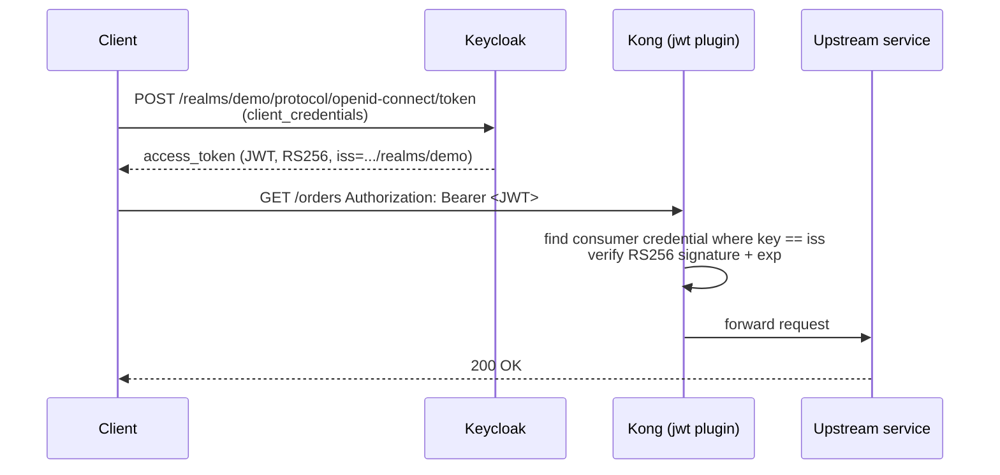

# Keycloak + Kong: JWT authentication for your APIs

!!! info "Version note"
    Tested with **Keycloak 26.x** and **Kong Gateway 3.9 (OSS)**, DB-less mode, November 2026. Kong's `openid-connect` plugin is **Enterprise-only**. This guide uses the bundled open-source **`jwt`** plugin, which validates Keycloak's RS256 tokens with the realm's public key.

## Introduction

- **[Keycloak](https://www.keycloak.org/)** is the identity provider. It authenticates users and services and issues signed JWT access tokens.
- **[Kong Gateway](https://konghq.com/)** is the API gateway. It sits in front of your services and rejects requests that don't carry a valid token.

Your services don't need to know anything about OAuth. Kong checks the token at the edge, so only authenticated requests reach the backend.



## How Kong's JWT plugin matches a token

This is the part that trips most people up, so it helps to understand it first:

1. Kong reads the token's **`iss`** claim. The claim it reads is set by `key_claim_name`, which defaults to `iss`.
2. It looks for a **consumer JWT credential whose `key` equals that value exactly**.
3. It verifies the signature with that credential's **`rsa_public_key`**, using the credential's `algorithm` (`RS256`).
4. It checks the claims listed in `claims_to_verify` (we use `exp`).

For Keycloak, `iss` is the **full realm URL**, for example `http://keycloak:8080/realms/demo`. The credential's `key` must be exactly that string.

## 1. Run Keycloak and Kong

```yaml title="docker-compose.yaml"
services:
  keycloak:
    image: quay.io/keycloak/keycloak:26.0
    command: start-dev
    environment:
      KC_BOOTSTRAP_ADMIN_USERNAME: admin
      KC_BOOTSTRAP_ADMIN_PASSWORD: change-me      # lab only
      KC_HOSTNAME: http://keycloak:8080           # fixes the issuer, see Troubleshooting
    ports: ["8080:8080"]

  kong:
    image: kong:3.9
    environment:
      KONG_DATABASE: "off"
      KONG_DECLARATIVE_CONFIG: /kong/kong.yaml
      KONG_PROXY_LISTEN: 0.0.0.0:8000
      KONG_ADMIN_LISTEN: 0.0.0.0:8001
    volumes:
      - ./kong.yaml:/kong/kong.yaml:ro
    ports: ["8000:8000", "8001:8001"]

  httpbin:
    image: kennethreitz/httpbin
```

Add `127.0.0.1 keycloak` to your `/etc/hosts` so that your machine and the containers use the **same hostname** for Keycloak. This keeps the `iss` claim the same everywhere.

## 2. Configure Keycloak

In the admin console (`http://keycloak:8080`, log in as `admin`):

1. **Create a realm** called `demo`.
2. **Create a client** called `orders-api-client`:
    - Client authentication: **On** (confidential client)
    - Service accounts roles: **On** (enables `client_credentials`)
    - Standard flow: Off (machine-to-machine only)
3. Copy the client secret from the **Credentials** tab.
4. Get the realm's **public key**:

    ```bash
    curl -s http://keycloak:8080/realms/demo | jq -r .public_key
    ```

    This prints the bare base64 key. Kong needs it in **PEM** form, so wrap it like this:

    ```text
    -----BEGIN PUBLIC KEY-----
    MIIBIjANBgkqhkiG9w0BAQEFAAOCAQ8AMIIBCgKCAQEA...
    -----END PUBLIC KEY-----
    ```

## 3. Configure Kong with decK (declarative)

```yaml title="kong.yaml"
_format_version: "3.0"

services:
  - name: orders
    url: http://httpbin:80
    routes:
      - name: orders-route
        paths: ["/orders"]
    plugins:
      - name: jwt
        config:
          key_claim_name: iss          # default, shown for clarity
          claims_to_verify: [exp]
          header_names: [authorization]

consumers:
  - username: keycloak-demo-realm
    jwt_secrets:
      - key: http://keycloak:8080/realms/demo   # must equal the token's iss exactly
        algorithm: RS256
        rsa_public_key: |
          -----BEGIN PUBLIC KEY-----
          MIIBIjANBgkqhkiG9w0BAQEFAAOCAQ8AMIIBCgKCAQEA...
          -----END PUBLIC KEY-----
```

```bash
docker compose up -d
# After editing kong.yaml:
docker compose restart kong
```

??? tip "Running Kong on Kubernetes?"
    With the Kong Ingress Controller, the same setup becomes:

    - a `KongPlugin` (`plugin: jwt`) attached to your Ingress or HTTPRoute with the `konghq.com/plugins` annotation,
    - a `KongConsumer` with `credentials: [keycloak-jwt]`,
    - a Secret labelled `konghq.com/credential: jwt` that holds `key`, `algorithm: RS256` and `rsa_public_key`.

## 4. Test it

```bash
# No token → 401
curl -i http://localhost:8000/orders/get

# Get a token from Keycloak
TOKEN=$(curl -s -X POST http://keycloak:8080/realms/demo/protocol/openid-connect/token \
  -d grant_type=client_credentials \
  -d client_id=orders-api-client \
  -d client_secret="<client-secret>" | jq -r .access_token)

# Inspect the claims: check that iss matches the consumer key
echo "$TOKEN" | jq -R 'split(".")[1] | @base64d | fromjson | {iss, exp, azp}'   # jq 1.6+

# With token → 200
curl -i http://localhost:8000/orders/get -H "Authorization: Bearer $TOKEN"
```

Kong adds `X-Consumer-Username: keycloak-demo-realm` to the upstream request. httpbin echoes it back, so you can see the match.

## Going further

- **Authorization, not just authentication.** The `jwt` plugin only proves that the token is valid. To check roles or scopes, add a plugin such as `acl` (map Keycloak clients to Kong consumer groups) or a policy engine (OPA). You can also check `realm_access.roles` in the service itself.
- **Key rotation.** When Keycloak rotates the realm key, the old public key in Kong stops matching. Automate the update by fetching `/realms/<realm>/protocol/openid-connect/certs` in CI and running `deck gateway sync`.
- **Rate limiting per client.** Each Keycloak realm or client becomes a Kong consumer, so you can attach `rate-limiting` per consumer.
- **The same pattern for agents.** [Agent Gateway](../AgenticAI/agent-gateway.md) can validate the same Keycloak tokens in front of MCP servers.

## Troubleshooting

| Kong response | Cause | Fix |
| --- | --- | --- |
| `401 No credentials found for given 'iss'` | The token's `iss` does not equal the consumer's `key`. This is the most common failure. | Decode the token and copy `iss` exactly, including scheme, host, port and `/realms/<realm>`, with no trailing slash. Make clients and Kong reach Keycloak by the same hostname, or set `KC_HOSTNAME`. |
| `401 Invalid signature` | Wrong or stale public key, or not in PEM form | Fetch `public_key` again and wrap it in `BEGIN/END PUBLIC KEY`. Check that the key wasn't rotated. |
| `401 Unauthorized` (no detail) | No `Authorization: Bearer` header | Check `header_names` and how the client sends the token |
| `401 token expired` | `exp` is in the past | Get a new token. Check clock sync. Keycloak's default access-token lifetime is 5 minutes. |
| `401 Invalid algorithm` | The credential's `algorithm` doesn't match the token's `alg` | Keycloak signs with `RS256` by default. Set `algorithm: RS256`. |
| Works with curl, fails from the app | The app requests tokens through a different Keycloak URL, so `iss` differs | Use one public Keycloak hostname for all clients |

## References

- [Kong JWT plugin](https://docs.konghq.com/hub/kong-inc/jwt/)
- [decK declarative config](https://docs.konghq.com/deck/)
- [Keycloak server administration](https://www.keycloak.org/docs/latest/server_admin/)
- [Keycloak hostname configuration](https://www.keycloak.org/server/hostname)
